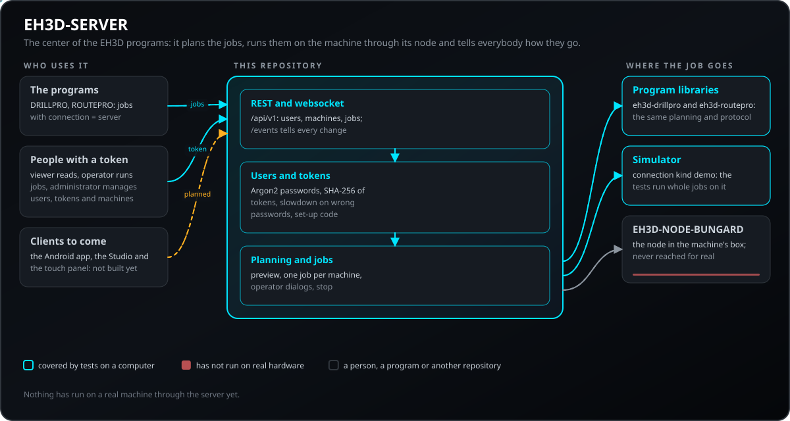
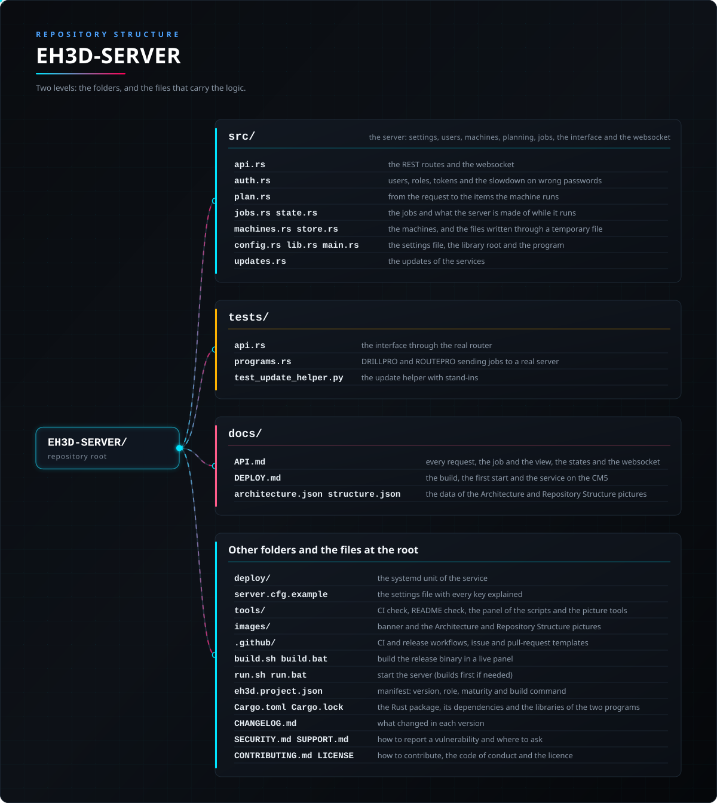

<p align="center">
  
</p>

# 🧭 EH3D-SERVER

<p align="center"><a href="README.md">🇺🇸 English</a> | <a href="README_spa.md">🇪🇸 Español</a> | <a href="README_fra.md">🇫🇷 Français</a> | 🇮🇹 <b>Italiano</b> | <a href="README_deu.md">🇩🇪 Deutsch</a> | <a href="README_zho.md">🇨🇳 中文</a> | <a href="README_jpn.md">🇯🇵 日本語</a> | <a href="README_por.md">🇵🇹 Português</a></p>

### Il centro dei programmi EH3D: riceve i lavori da DRILLPRO, ROUTEPRO e dai client futuri, li pianifica, li esegue sulla macchina tramite il suo nodo e racconta a tutti come procedono

<p align="center">
  
  
  
  
  
</p>

---

**Verifica di onestà - cosa funziona oggi:** un server Rust (axum) con interfaccia REST e websocket che tiene utenti, macchine e lavori, pianifica un lavoro di foratura o di fresatura (fori e percorsi, oppure un file Excellon o HP-GL con la sua tabella utensili) con le librerie di EH3D-DRILLPRO ed EH3D-ROUTEPRO, mostra un'anteprima e lo esegue su una macchina tramite il suo EH3D-NODE-BUNGARD o su un simulatore, con i dialoghi dell'operatore, uno stop e ogni cambiamento comunicato man mano. 41 test girano su un computer, i lavori contro il simulatore. **Finora nulla è stato eseguito su una macchina reale attraverso di esso**, non termina il TLS, e dei client oltre ai programmi, EH3D-STUDIO esiste (mai provato con una macchina reale) e l'app Android e il pannello accanto alla macchina non esistono ancora.

---

> **Stato di sicurezza funzionale e informatica:** questo non è un sistema di sicurezza funzionale. Un lavoro non parte mai da solo: lo avvia una persona con il ruolo di operatore, un lavoro alla volta su una macchina, e la pianificazione rifiuta fori e percorsi fuori dal tavolo e utensili mancanti o fuori intervallo. Ogni richiesta richiede un token (un osservatore legge, un operatore esegue lavori, un amministratore gestisce utenti, token e macchine); le password sono conservate come hash Argon2, i token di sessione e di programma solo come SHA-256, e il token di un nodo non viene mai mostrato dall'API. Il server è pensato per la casa o una VPN verso di essa: metti HTTPS davanti prima che qualcosa dall'esterno lo raggiunga. L'arresto della macchina non dipende dal solo server: il nodo si ferma da solo quando il suo collegamento tace. Il progetto è indipendente: non è prodotto, approvato né supportato da Bungard Elektronik.

## 📋 In breve

| | |
|---|---|
| Versione | `0.0.2` |
| Maturità | Impalcatura |
| Test | 55 |
| Stack tecnologico | Rust (axum, tokio) |
| Su hardware reale | No: provato contro il simulatore; finora nulla è stato eseguito su una macchina reale tramite il server |

**Vai a:** [Panoramica](#-panoramica) · [Architettura](#-architettura) · [Avvio rapido](#-avvio-rapido) · [Test](#-test) · [Struttura](#-struttura-del-repository) · [Correlati](#-progetti-correlati)

## 🚦 Stato del progetto

Ogni riga è una parte di questo repository e il semaforo dice a che punto è oggi. È scritta in base a ciò che il repository può mostrare (test, compilazioni, esecuzioni), non a ciò che è previsto.

🟢 Fatto e verificato · 🟡 Funziona, con limiti noti · 🟠 Fatto a metà o non ancora verificato · 🔴 Non fatto o non funzionante

| Area | Stato | Cosa significa qui |
|---|---|---|
| Software | 🟡 | Un server Rust (axum) tiene utenti, macchine e lavori, pianifica lavori di foratura e fresatura con le librerie di EH3D-DRILLPRO ed EH3D-ROUTEPRO, mostra un'anteprima ed esegue il lavoro con dialoghi dell'operatore e uno stop. |
| Test | 🟢 | Passano 55 test (`cargo test`): 38 nei moduli e 17 sull'interfaccia end to end, con lavori sul simulatore (12 in `tests/api.rs`, 4 con i programmi reali in `tests/programs.rs`). |
| Interfaccia per i client (API) | 🟡 | Le richieste REST e gli eventi websocket sono descritti in `docs/API.md` e coperti dai test; finora li usa solo la connessione al server dei programmi stessi. |
| Client | 🔴 | EH3D-STUDIO lo usa (mai provato con una macchina reale); l'app Android e il pannello touch accanto alla macchina non esistono ancora. |
| Sicurezza | 🟡 | Ogni richiesta richiede un token con uno di tre ruoli, le password sono hash Argon2 e le password sbagliate vengono rallentate; il server non termina il TLS (metti HTTPS davanti) e non ha avuto una revisione indipendente. |
| Hardware reale | 🟠 | I lavori sono stati eseguiti solo contro il simulatore: nulla è stato eseguito su una macchina reale tramite il server. |
| Distribuzione | 🟠 | Un'unità systemd e `docs/DEPLOY.md` descrivono il servizio sulla CM5; questo repository non registra alcuna distribuzione come fatta. |
| Integrazione | 🟡 | Pianifica con le stesse librerie di EH3D-DRILLPRO ed EH3D-ROUTEPRO (le loro cartelle devono stare accanto a questa) e parla con il collegamento di EH3D-NODE-BUNGARD, raggiunto solo tramite il simulatore. |
| Documentazione | 🟢 | README in otto lingue, il riferimento dell'API e la guida per eseguirlo come servizio. |

## 🎯 Panoramica

* I **lavori**: un lavoro di foratura (fori e utensili, o un file `.NCD` con la sua tabella utensili) o di fresatura (percorsi e utensili, o un file `.PLT` con la sua tabella utensili), pianificato con le librerie dei programmi, così un client disegna e la macchina fa esattamente la stessa cosa; rifiutato con un codice quando un foro è fuori dal tavolo o manca un utensile.
* L'**anteprima**: il lavoro nell'ordine in cui lo fa la macchina, gli utensili con il loro numero, il riquadro, una stima del tempo e l'elemento a cui ogni foro è finito - ciò che serve a uno schermo per disegnare la scheda e seguire il lavoro.
* L'**esecuzione**: un lavoro è pronto finché una persona lo avvia; gira sulla libreria dei programmi (handshake, armamento, riferimento, fori, stop), attende ai dialoghi dell'operatore (cambia l'utensile, conferma il mandrino) finché qualcuno conferma, e può essere fermato; la macchina si ferma con i driver spenti.
* Le **macchine**: per ognuna, come raggiungerla (un EH3D-NODE-BUNGARD via rete, o il simulatore), il testo dei suoi file di configurazione e i valori tarati su di essa, così la calibrazione di una macchina vive in un solo posto per tutti i client.
* La **flotta e le stazioni**: ogni macchina appartiene a una stazione (il banco, la sala, l'officina) e `GET /api/v1/fleet` risponde per tutte insieme, raggruppate per stazione, con ciò che fa ciascuna (libera, occupata, in attesa dell'operatore), il suo lavoro con l'avanzamento e il numero di lavori pronti; le macchine lavorano insieme, un lavoro su ciascuna.
* Le **persone e i programmi**: utenti con tre ruoli, token per i programmi mostrati una sola volta, un rallentamento sulle password sbagliate e un codice di configurazione sulla console per il primo amministratore.
* Gli **eventi**: un websocket che invia ogni cambiamento di un lavoro man mano che avviene.
* Il **servizio**: un binario e un piccolo file di impostazioni di testo, sulla porta 18200 per impostazione predefinita (non quella di ARMOR né di HYDRA-UMC), con un'unità systemd per la CM5.
* **Previsto, non ancora costruito**: i client (l'app Android, lo Studio, il pannello touch accanto alla macchina), HTTPS nel server stesso e l'uso dei LED del nodo e del suo buffer per finire un lavoro trattenuto quando il server sparisce.

## 🧩 Ruolo in EH3D

EH3D-SERVER è il centro della famiglia EH3D: i programmi gli inviano i loro lavori, parla con le macchine tramite i loro nodi, e gli altri client vedono e inviano gli stessi lavori attraverso la stessa interfaccia. Usa le librerie di [EH3D-DRILLPRO](https://github.com/JuanenRac/EH3D-DRILLPRO) ed [EH3D-ROUTEPRO](https://github.com/JuanenRac/EH3D-ROUTEPRO) e parla con [EH3D-NODE-BUNGARD](https://github.com/JuanenRac/EH3D-NODE-BUNGARD).

## 🏛️ Architettura

<p align="center">
  
</p>

Come si incastrano le parti di questo repository: chi lo usa, che cosa contiene e da che cosa dipende. L'immagine è disegnata da `docs/architecture.json` e verificata rispetto al codice.

## ✨ Funzionalità

* **Un'anteprima che è il piano:** l'anteprima e l'esecuzione reale vengono dalla stessa pianificazione, quindi ciò che il client disegna è ciò che fa la macchina.
* **Un lavoro non parte mai da solo:** viene creato pronto e solo un operatore lo avvia; un lavoro alla volta su una macchina (`409 machine_busy`).
* **Dialoghi dell'operatore via rete:** il lavoro si ferma al cambio utensile e alla conferma del mandrino finché un client conferma.
* **Eventi dal vivo:** un websocket comunica ogni cambiamento di un lavoro man mano che avviene, con i riepiloghi dei lavori alla connessione.
* **Calibrazione in un solo posto:** i file di configurazione e i valori tarati di ogni macchina sono tenuti sul server, quindi tutti i client pianificano con gli stessi numeri.
* **Un lavoro in corso quando il server si è fermato è segnato come fallito:** nessuno sa dov'era la macchina, quindi nulla riprende da solo.
* **File sicuri:** utenti, token, macchine e lavori sono file JSON scritti tramite uno temporaneo; un file danneggiato è un errore, mai un riavvio silenzioso da zero.
* **Aggiornamenti da GitHub:** con `updates_dir` il server offre a un amministratore il controllo delle ultime release di sé stesso e di EH3D-STUDIO e il loro aggiornamento (`/api/v1/updates`); un piccolo helper avviato da systemd (`deploy/eh3d-update.py`) scarica, verifica lo SHA-256 di ogni file, rifiuta un archivio con nomi fuori dalla sua cartella, sostituisce la cartella installata (la precedente resta come `.previous`) e riavvia il servizio. È stato provato con GitHub e systemd sostituiti da simulazioni, mai su un'installazione reale.
* **Il nodo della testa di foratura tramite il server:** quando la configurazione di una macchina nomina il nodo (`head_address`, `head_token`), il server inoltra il suo stato (`GET /api/v1/machines/:id/head/status`), la sua telecamera come MJPEG (`.../head/stream`, con il token nell'indirizzo per un browser) e una misura del tavolo (`POST .../head/measure`, operatore), così un programma su un'altra rete lo raggiunge con lo stesso accesso. Provato con un nodo simulato, mai con uno reale.
* **Il controllo qualità con la telecamera della testa:** il server accende l'anello di LED, scatta una foto dal nodo, la giudica con l'analizzatore dell'officina (il profilo di ogni macchina è conservato dal server), fa dire all'anello com'è andata (verde, o rosso lampeggiante) e conserva l'ultimo controllo perché lo schermo accanto alla macchina e i telefoni lo mostrino: `GET/POST .../head/light`, `GET .../head/snapshot`, `POST/GET .../head/inspect`, `GET/PUT .../head/inspect/profile` e `POST .../head/inspect/calibrate`.

## 🔒 Sicurezza e protezione

| Minaccia | Difesa |
|---|---|
| Chiunque sulla rete invii richieste | ogni richiesta tranne il controllo di salute, la prima configurazione e il login richiede un token (`Authorization: Bearer`, o `?token=` per il websocket); tre ruoli: l'osservatore legge, l'operatore esegue lavori, l'amministratore gestisce utenti, token e macchine |
| Indovinare una password | cinque password sbagliate bloccano il nome, 30 s e poi 60 s, 120 s e così via finché continuano (`429 throttled`); la risposta non dice quale parte era sbagliata, e un nome sconosciuto costa quanto uno noto |
| Una copia della cartella dati | le password sono hash Argon2id; i token di sessione e di programma sono casuali e se ne conserva solo lo SHA-256, quindi una copia della cartella non fa entrare nessuno; il token di un nodo non viene mai mostrato dall'API |
| Prendere il controllo di un server nuovo | il primo amministratore si crea con un codice di configurazione che stampa solo la console |
| Chiudere fuori tutti | l'ultimo amministratore non può essere eliminato, disattivato né declassato (`409 last_admin`) |
| Un lavoro che parte da solo o un secondo lavoro su una macchina | un lavoro viene creato pronto; solo un operatore lo avvia, e una macchina esegue un lavoro alla volta |
| Un piano che colpirebbe il tavolo o userebbe un utensile mancante | la pianificazione rifiuta con un codice fori e percorsi fuori dal tavolo e utensili mancanti o fuori intervallo |
| Il server muore mentre la macchina si muove | il nodo si ferma da solo quando il suo collegamento tace; il lavoro è segnato come fallito e non riprende da solo; il servizio ferma i suoi lavori con SIGINT |
| Una richiesta enorme | il corpo è limitato (`max_body_mb`, 8 MB per impostazione predefinita) |
| Un file di dati danneggiato | un errore, mai un avvio silenzioso da zero |
| Un servizio con troppi diritti | l'unità systemd gira con un utente proprio con `NoNewPrivileges`, `ProtectSystem=strict`, `PrivateTmp` e una sola cartella scrivibile |

**Ciò che non è difeso:** il server non termina il TLS, quindi token e password attraversano la rete in chiaro a meno che si metta HTTPS davanti; il token del websocket è nell'indirizzo; non ha avuto una revisione indipendente. Segnala una vulnerabilità in privato (vedi [SECURITY.md](SECURITY.md)).

## 🔌 Interfacce

| Interfaccia | Che cos'è | Dove |
|---|---|---|
| REST | `/api/v1/`: `health`, `setup`, `login`, `logout`, `session`, `account`, `users`, `tokens`, `updates`, `machines` (con `preview` e `jobs`), `jobs` (con `start`, `confirm`, `cancel`); JSON in entrata e in uscita, errori come `{"error","detail"}` | [docs/API.md](docs/API.md), `src/api.rs` |
| Websocket | `GET /api/v1/events?token=...`: un `hello` con i riepiloghi dei lavori, poi `job` e `job_removed` a ogni cambiamento | [docs/API.md](docs/API.md) |
| Verso la macchina | la `connection` di una macchina è `node` (un EH3D-NODE-BUNGARD a un indirizzo con il suo token) o `demo` (il simulatore) | [docs/API.md](docs/API.md), `src/machines.rs` |
| Riga di comando | `eh3d-server [--config FILE]`; `--help` la elenca | `src/main.rs` |
| Servizio | un binario, porta 18200 per impostazione predefinita, un'unità systemd | [docs/DEPLOY.md](docs/DEPLOY.md), `deploy/eh3d-server.service` |

## ⚙️ Configurazione

`server.cfg` (o il file indicato con `--config`) contiene cinque chiavi facoltative; una chiave sconosciuta o un valore fuori intervallo è un errore all'avvio. `server.cfg.example` le spiega.

| Chiave | Predefinito | Intervallo | Cosa fa |
|---|---|---|---|
| `listen` | `0.0.0.0:18200` | un indirizzo e una porta | dove il server ascolta (18200 è la sua porta) |
| `data_dir` | `data` | una cartella | dove si conservano utenti, token, macchine e lavori; fanne un backup |
| `session_hours` | 12 | da 1 a 720 | quanto dura un login |
| `max_body_mb` | 8 | da 1 a 256 | la richiesta più grande, in megabyte |
| `keep_jobs` | 200 | da 10 a 100.000 | quanti lavori finiti conserva l'elenco |

Nomi di utenti e token: lettere, cifre, `.`, `_` e `-`, fino a 32 caratteri; password: da 8 a 128 caratteri. I valori tarati su ogni macchina non sono qui: stanno nella scheda della macchina, nel formato del file macchina dei programmi.

## 🚀 Avvio rapido

Serve una toolchain Rust stabile, ed EH3D-DRILLPRO ed EH3D-ROUTEPRO accanto a questa cartella (il server usa le loro librerie).

```bash
cargo build --release
cargo test
cargo clippy --all-targets -- -D warnings
cargo fmt --all --check
python -I tools/ci_validate.py
```

Avvialo con `run.bat` (Windows) o `./run.sh` (Linux); compila prima se serve. Finché non ha utenti, la console mostra un codice di configurazione: crea l'amministratore con `POST /api/v1/setup`, accedi, aggiungi la macchina con l'indirizzo e il token del suo nodo e crea un token per ogni programma. `server.cfg.example` elenca le impostazioni; `docs/DEPLOY.md` lo installa come servizio sulla CM5.

## 🧪 Test

La suite ha 55 test (`cargo test`, eseguiti su Windows e Linux nella CI con COMMON, DRILLPRO e ROUTEPRO scaricati accanto al server): 38 nei moduli (impostazioni e loro intervalli, utenti, ruoli, token, il rallentamento sulle password sbagliate, i file e il registro dei lavori, la pianificazione), 12 sull'interfaccia end to end attraverso il vero router (`tests/api.rs`) e 5 con i programmi reali che inviano i loro lavori a un vero server su una vera porta, con la macchina sul simulatore (`tests/programs.rs`). La CI esegue anche `cargo fmt --all --check`, `cargo clippy` con gli avvisi come errori e `python -I tools/ci_validate.py`. Nulla di questo è stato provato contro un nodo o una macchina reali. L'helper che fa gli aggiornamenti ha altri 10 test propri (`python -I tests/test_update_helper.py`, con GitHub e systemd sostituiti da simulazioni).

## 🏗️ Compilazione e rilascio

La versione sta in `Cargo.toml` e in `eh3d.project.json`, e ogni versione ha la sua voce in [CHANGELOG.md](CHANGELOG.md). `build.sh` / `build.bat` compilano il binario di release (`target/release/eh3d-server`) con un pannello dal vivo, e `test.sh` / `test.bat` eseguono solo i test; nessuno cambia la versione. Non è ancora stata pubblicata alcuna versione. Su una CM5 (Linux aarch64) si compila sulla macchina stessa; `docs/DEPLOY.md` lo installa come servizio.

## 📂 Struttura del repository

<p align="center">
  
</p>

<details>
<summary>Versione testuale dell'albero</summary>

```text
EH3D-SERVER/
├── src/
│   ├── api.rs                                   le route REST e il websocket
│   ├── auth.rs                                  utenti, ruoli, token e rallentamento sulle password sbagliate
│   ├── plan.rs                                  dalla richiesta agli elementi che la macchina esegue
│   ├── jobs.rs state.rs                         i lavori e di cosa è fatto il server mentre gira
│   ├── machines.rs store.rs                     le macchine e i file scritti tramite uno temporaneo
│   ├── config.rs lib.rs main.rs                 il file delle impostazioni, la radice della libreria e il programma
│   ├── updates.rs  head.rs                      gli aggiornamenti dei servizi
│   └── inspect.rs                               il controllo qualità con la telecamera della testa
├── tests/                                       l'interfaccia end to end sul simulatore e i programmi reali contro un vero server
├── docs/                                        l'API, la guida per eseguire il server e i dati delle due immagini
├── deploy/                                      l'unità systemd del servizio
├── server.cfg.example                           il file delle impostazioni con ogni chiave spiegata
├── tools/                                       controllo della CI e del README, il pannello degli script e strumenti per le immagini
├── images/                                      banner e le immagini di Architettura e Struttura del repository
├── .github/                                     workflow di CI e di rilascio, modelli di issue e pull request
├── build.sh build.bat                           compila il binario di release con un pannello dal vivo
├── run.sh run.bat                               avvia il server (compila prima se serve)
├── eh3d.project.json                            manifesto: versione, ruolo, maturità e comando di compilazione
├── Cargo.toml Cargo.lock                        il pacchetto Rust, le sue dipendenze e le librerie dei due programmi
├── CHANGELOG.md                                 cosa è cambiato in ogni versione
├── SECURITY.md SUPPORT.md                       come segnalare una vulnerabilità e dove chiedere
└── CONTRIBUTING.md CODE_OF_CONDUCT.md LICENSE   come contribuire, codice di condotta e licenza
```

</details>

## 🗺️ Roadmap e limiti noti

**Limiti noti oggi**

* Nulla è stato eseguito su una macchina reale attraverso il server: i lavori hanno girato solo contro il simulatore e il collegamento con EH3D-NODE-BUNGARD non è stato raggiunto per davvero.
* Il server non termina il TLS; metti HTTPS davanti prima che qualcosa dall'esterno lo raggiunga. Non ha avuto una revisione indipendente.
* Dei client oltre ai programmi, EH3D-STUDIO esiste; l'app Android e il pannello touch non esistono ancora.
* Servono le cartelle di EH3D-DRILLPRO ed EH3D-ROUTEPRO accanto, perché usa le loro librerie.
* Un lavoro in corso quando il server si è fermato è segnato come fallito e non riprende.

**Prossimi passi**

* Eseguire un lavoro intero su una macchina reale tramite il server e il nodo.
* HTTPS nel server stesso.
* Usare i LED del nodo e il suo buffer per finire un lavoro trattenuto quando il server sparisce.
* Costruire il primo client oltre ai programmi.

## 🌍 Lingue

Il README e i testi esistono in inglese, spagnolo, francese, italiano, tedesco, cinese, giapponese e portoghese europeo.

## 🔗 Progetti correlati

* [EH3D-DRILLPRO](https://github.com/JuanenRac/EH3D-DRILLPRO): il programma di foratura; la sua libreria pianifica ed esegue i lavori di foratura
* [EH3D-ROUTEPRO](https://github.com/JuanenRac/EH3D-ROUTEPRO): il programma di fresatura; la sua libreria pianifica i lavori di fresatura
* [EH3D-NODE-BUNGARD](https://github.com/JuanenRac/EH3D-NODE-BUNGARD): il nodo nella scatola della macchina con cui parla il server
* [EH3D-COMMON](https://github.com/JuanenRac/EH3D-COMMON): le parti comuni della famiglia

## 📚 Documentazione

* [L'API](docs/API.md): ogni richiesta, il lavoro e la vista che disegna un client, gli stati e il websocket.
* [Eseguire il server](docs/DEPLOY.md): la compilazione, il primo avvio, il servizio sulla CM5 e la sicurezza della distribuzione.
* [Registro delle modifiche](CHANGELOG.md)

## 🤝 Contribuire e comunità

* Prima di una pull request esegui `cargo fmt --all --check`, `cargo clippy --all-targets -- -D warnings`, `cargo test` e `python -I tools/ci_validate.py`: tutto deve passare. Vedi [CONTRIBUTING.md](CONTRIBUTING.md) e il [codice di condotta](CODE_OF_CONDUCT.md).
* Il README esiste in otto lingue: una modifica al testo si fa in tutti e otto i file, e le due immagini sono disegnate da `docs/architecture.json` e `docs/structure.json` con `tools/make_architecture.py` e `tools/make_structure.py`.
* Una modifica a una route dell'API richiede la sua voce in `docs/API.md`, un test attraverso il vero router e, per una richiesta che cambia qualcosa, il ruolo che può farla.
* Segnala una vulnerabilità in privato: [SECURITY.md](SECURITY.md). Domande, idee e segnalazioni: electrohobby3d@gmail.com ([SUPPORT.md](SUPPORT.md)).

## 👤 AUTORE

**JuanenRac (Electro Hobby 3D)** · electrohobby3d@gmail.com

## 📜 LICENZA

Software: GPL-3.0-or-later. Vedi [LICENSE](LICENSE). I progetti hardware della suite usano la CERN OHL-S.
