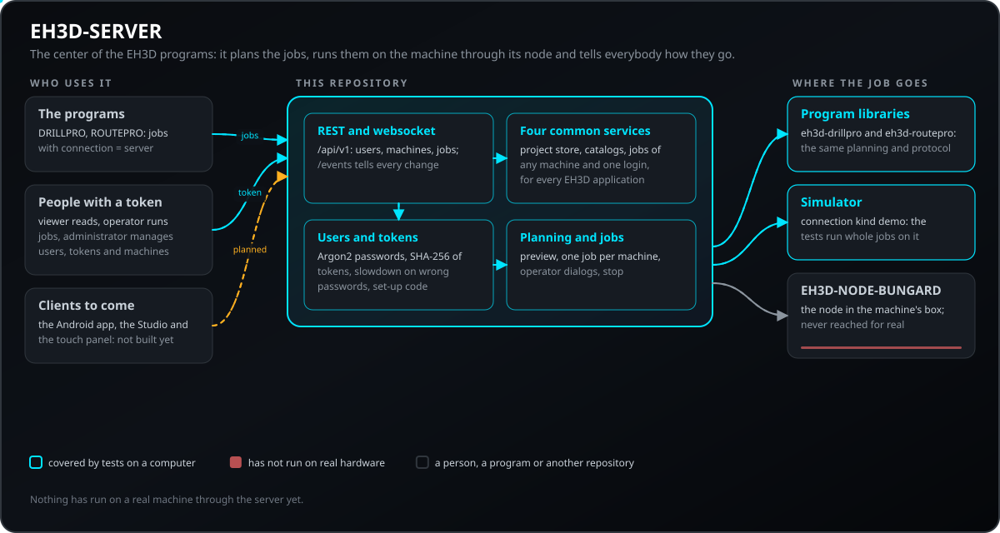
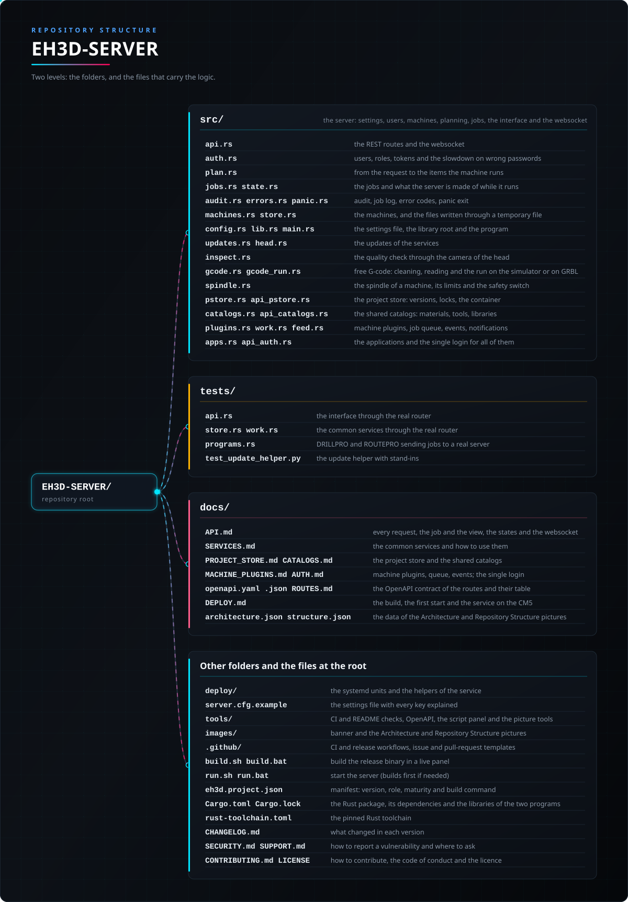

<p align="center">
  
</p>

#  EH3D-SERVER

<p align="center"><a href="README.md">🇺🇸 English</a> | 🇪🇸 <b>Español</b> | <a href="README_fra.md">🇫🇷 Français</a> | <a href="README_ita.md">🇮🇹 Italiano</a> | <a href="README_deu.md">🇩🇪 Deutsch</a> | <a href="README_zho.md">🇨🇳 中文</a> | <a href="README_jpn.md">🇯🇵 日本語</a> | <a href="README_por.md">🇵🇹 Português</a></p>

### El centro de los programas EH3D: recibe trabajos de DRILLPRO, ROUTEPRO y de los clientes futuros, los planifica, los ejecuta en la máquina a través de su nodo y cuenta a todos cómo van

<p align="center">
  
  
  
  
  
</p>

---

**Comprobación de honestidad - lo que se ejecuta hoy:** un servidor en Rust (axum) con interfaz REST y websocket que guarda usuarios, máquinas y trabajos, planifica un trabajo de taladrado o de fresado (agujeros y trayectorias, o un fichero Excellon o HP-GL con su tabla de herramientas) con las bibliotecas de EH3D-DRILLPRO y EH3D-ROUTEPRO, muestra una vista previa y lo ejecuta en una máquina a través de su EH3D-NODE-BUNGARD o en un simulador, con los diálogos del operador, una parada y cada cambio contado según ocurre. 360 pruebas se ejecutan en un ordenador, los trabajos contra el simulador. **Todavía no se ha ejecutado nada en una máquina real a través de él**, no termina TLS y de los clientes además de los programas, EH3D-STUDIO existe (nunca probado con una máquina real) y la app de Android y el panel junto a la máquina todavía no existen. También es el servidor de toda aplicación de EH3D, con cuatro servicios comunes (un almacén de proyectos, catálogos compartidos, plugins de máquina con una cola de trabajos y un flujo de eventos, y un inicio de sesión único); solo se ejecutan en las pruebas y ninguna aplicación los usa todavía.

---

> **Estado de seguridad (safety) y de seguridad informática:** esto no es un sistema de seguridad (safety). Un trabajo nunca arranca solo: lo arranca una persona con el rol de operador, un trabajo cada vez en una máquina, y la planificación rechaza agujeros y trayectorias fuera de la mesa y herramientas que faltan o están fuera de rango. Cada petición necesita un token (un observador lee, un operador ejecuta trabajos, un administrador gestiona usuarios, tokens y máquinas); las contraseñas se guardan como hashes Argon2, los tokens de sesión y de programa solo como SHA-256, y la API nunca muestra el token de un nodo. El servidor es para la casa o una VPN hacia ella: pon HTTPS delante antes de que le llegue nada de fuera. La parada de la máquina no depende solo del servidor: el nodo se detiene solo cuando su enlace calla. El proyecto es independiente: no está hecho, avalado ni respaldado por Bungard Elektronik.

## 📋 De un vistazo

| | |
|---|---|
| Versión | `0.1.5` |
| Madurez | Funcional |
| Pruebas | 360 |
| Pila tecnológica | Rust (axum, tokio) |
| En hardware real | No: probado contra el simulador; todavía no se ha ejecutado nada en una máquina real a través del servidor |

**Ir a:** [Resumen](#-resumen) · [Arquitectura](#-arquitectura) · [Inicio rápido](#-inicio-rápido) · [Pruebas](#-pruebas) · [Estructura](#-estructura-del-repositorio) · [Relacionados](#-proyectos-relacionados)

## 🚦 Estado del proyecto

Cada línea es una parte de este repositorio y la luz dice hasta dónde llega hoy. Se escribe con lo que el repositorio puede demostrar (pruebas, compilaciones, ejecuciones), no con lo previsto.

🟢 Hecho y verificado · 🟡 Funciona, con límites conocidos · 🟠 Hecho a medias o sin verificar · 🔴 Sin hacer o sin funcionar

| Área | Estado | Qué significa aquí |
|---|---|---|
| Software | 🟡 | Un servidor en Rust (axum) guarda usuarios, máquinas y trabajos, planifica trabajos de taladrado y fresado con las bibliotecas de EH3D-DRILLPRO y EH3D-ROUTEPRO, muestra una vista previa y ejecuta el trabajo con diálogos de operador y una parada. |
| Pruebas | 🟡 | Pasan 360 pruebas (`cargo test`): 198 en los módulos y 162 de la interfaz de extremo a extremo, con trabajos en el simulador (41 en `tests/api.rs`, 7 con los programas reales en `tests/programs.rs`). |
| Interfaz para clientes (API) | 🟡 | Las peticiones REST y los eventos del websocket están escritos en `docs/API.md` (las rutas, además, en el contrato OpenAPI `docs/openapi.yaml`) y cubiertos por las pruebas; hasta ahora solo los usa la conexión al servidor de los propios programas. |
| Servicios comunes | 🟠 | El almacén de proyectos, los catálogos compartidos, los plugins de máquina con su cola y sus eventos, y el inicio de sesión único funcionan en las pruebas en un ordenador; ninguna aplicación los usa todavía, nada ha corrido en una máquina real a través de la cola y los catálogos no se han cargado con los datos reales de sus programas. |
| Clientes | 🔴 | EH3D-STUDIO lo usa (nunca probado con una máquina real); la app de Android y el panel táctil junto a la máquina todavía no existen. |
| Seguridad | 🟡 | Cada petición necesita un token con uno de tres roles, las contraseñas son hashes Argon2 y las contraseñas erróneas se ralentizan; el servidor no termina TLS (pon HTTPS delante) y no ha tenido revisión independiente. |
| Hardware real | 🟠 | Los trabajos solo se han ejecutado contra el simulador: nada se ha ejecutado en una máquina real a través del servidor. |
| Despliegue | 🟠 | Una unidad de systemd y `docs/DEPLOY.md` describen el servicio en la CM5; este repositorio no registra ningún despliegue como hecho. |
| Integración | 🟠 | Planifica con las mismas bibliotecas que EH3D-DRILLPRO y EH3D-ROUTEPRO (sus carpetas deben estar junto a esta) y habla con el enlace de EH3D-NODE-BUNGARD, al que solo ha llegado a través del simulador. |
| Documentación | 🟡 | README en ocho idiomas, la referencia de la API y la guía para ejecutarlo como servicio. |

## 🎯 Resumen

* Los **trabajos**: un trabajo de taladrado (agujeros y herramientas, o un fichero `.NCD` con su tabla de herramientas) o de fresado (trayectorias y herramientas, o un fichero `.PLT` con su tabla de herramientas), planificado con las bibliotecas de los programas, de modo que el cliente dibuja y la máquina hace exactamente lo mismo; se rechaza con un código cuando un agujero queda fuera de la mesa o falta una herramienta.
* **Trabajos de G-code libre:** un trabajo `kind: gcode` lleva el texto de un programa; el servidor lo limpia (sin comentarios ni órdenes de ajustes del controlador), juzga su `S` y su `F` contra el husillo de la máquina y lo ejecuta línea a línea en el simulador o en un controlador GRBL de un puerto serie del servidor (`connection.kind = grbl`, una compilación con `--features serial`). El trabajo puede pausarse (`pause`), soltarse (`resume`) y detenerse (`cancel`), y uno que se detuvo sigue desde la línea a la que llegó: se devuelven los códigos en vigor y el trabajo espera al operador antes del primer movimiento. Probado solo en el simulador, nunca en un controlador GRBL real.
* La **vista previa**: el trabajo en el orden en que lo hace la máquina, las herramientas con su número, la caja envolvente, una estimación del tiempo y el elemento en el que termina cada agujero: lo que una pantalla necesita para dibujar la placa y seguir el trabajo.
* La **ejecución**: un trabajo está listo hasta que una persona lo arranca; corre sobre la biblioteca de los programas (el saludo, el armado, la referencia, los agujeros, la parada), espera en los diálogos del operador (cambiar la herramienta, confirmar el husillo) hasta que alguien confirma, y se puede parar; la máquina se detiene con los drivers apagados.
* Las **máquinas**: de cada una, cómo llegar a ella (un EH3D-NODE-BUNGARD por la red, o el simulador), el texto de sus ficheros de configuración y los valores ajustados en ella, de modo que la calibración de una máquina vive en un solo sitio para todos los clientes.
* La **flota y las estaciones**: cada máquina pertenece a una estación (el banco, la sala, el taller) y `GET /api/v1/fleet` responde por todas a la vez, agrupadas por estación, con lo que hace cada una (libre, ocupada, esperando al operador), su trabajo con el progreso y el número de trabajos listos; las máquinas trabajan a la vez, un trabajo en cada una.
* Las **personas y los programas**: usuarios con tres roles, tokens para programas que se muestran una vez, una ralentización ante contraseñas erróneas y un código de puesta en marcha en la consola para el primer administrador.
* Los **eventos**: un websocket que envía cada cambio de un trabajo según ocurre.
* El **servicio**: un binario y un pequeño fichero de texto de ajustes, en el puerto 18200 por defecto (no el de ARMOR ni el de HYDRA-UMC), con una unidad de systemd para la CM5.
* **Previsto, aún sin construir**: los clientes (la app de Android, el Studio, el panel con pantalla táctil junto a la máquina), HTTPS en el propio servidor y el uso de los LED del nodo y su búfer para terminar un trabajo retenido cuando el servidor desaparece.
* **Una simulación en seco del plan exacto y comprobaciones de cordura en la vista de cada trabajo:** los pasos de un trabajo de taladrado o fresado se siguen sobre el papel, como los lee la controladora, y la vista lleva `dry_run` (hasta dónde llega cada eje desde sus finales, dónde acaba el plan, los pasos y los segundos) y `warnings` (una unidad probablemente equivocada, un trabajo mayor que la mesa, una escala distinta de 1). Un plan que saca un eje del recorrido del archivo de la máquina se rechaza con `outside_course`, o solo se lista cuando el ajuste de la máquina dice `dry_run = warn`; `dry_run_margin_mm`, `sanity_tiny_mm` y `sanity_far_mm` son claves del mismo ajuste. La medida y el resumen vienen de `eh3d-summary` en EH3D-COMMON, de modo que todos los programas dicen lo mismo.
* **Los cuatro servicios comunes, para toda aplicación de EH3D:** un **almacén de proyectos** (ficheros con todas las versiones conservadas y comprobadas, `If-Match` para que dos personas no se pisen, un bloqueo de edición, importación y exportación del contenedor `.eh3dproj`), **catálogos compartidos** (materiales, herramientas, perfiles de máquina, bibliotecas y la base de componentes, con búsqueda y `ETag`), **plugins de máquina** (cualquier tipo de máquina tras una sola interfaz, una cola de trabajos con historial, un flujo de eventos del servidor y notificaciones) y **un solo inicio de sesión** (la aplicación y el rol como datos de la sesión, sesiones que se pueden listar y cerrar, una política de contraseñas y de bloqueo). Véase [docs/SERVICES.md](docs/SERVICES.md).

## 🧩 Papel en EH3D

EH3D-SERVER es el centro de la familia EH3D: los programas le envían sus trabajos, habla con las máquinas a través de sus nodos y los demás clientes ven y envían los mismos trabajos por la misma interfaz. Usa las bibliotecas de [EH3D-DRILLPRO](https://github.com/JuanenRac/EH3D-DRILLPRO) y [EH3D-ROUTEPRO](https://github.com/JuanenRac/EH3D-ROUTEPRO) y habla con [EH3D-NODE-BUNGARD](https://github.com/JuanenRac/EH3D-NODE-BUNGARD).

## 🏛️ Arquitectura

<p align="center">
  
</p>

Cómo encajan las partes de este repositorio: quién lo usa, qué contiene y de qué depende. La imagen se dibuja desde `docs/architecture.json` y se comprueba contra el código.

## ✨ Funciones

* **Una vista previa que es el plan:** la vista previa y la ejecución real salen de la misma planificación, así que lo que dibuja el cliente es lo que hace la máquina.
* **Un trabajo nunca arranca solo:** se crea listo y solo lo arranca un operador; un trabajo cada vez en una máquina (`409 machine_busy`).
* **Diálogos del operador por la red:** el trabajo se detiene en el cambio de herramienta y en la confirmación del husillo hasta que un cliente confirma.
* **Eventos en vivo:** un websocket cuenta cada cambio de un trabajo según ocurre, con el resumen de los trabajos al conectar.
* **Calibración en un solo sitio:** los ficheros de configuración y los valores ajustados de cada máquina se guardan en el servidor, así que todos los clientes planifican con los mismos números.
* **Un trabajo que corría cuando el servidor se detuvo se marca como fallido:** nadie sabe dónde estaba la máquina, así que nada se reanuda solo.
* **Ficheros duraderos:** los usuarios, los tokens, las máquinas y los trabajos son ficheros JSON que se escriben mediante un fichero temporal que se vuelca al disco antes de sustituir al antiguo, y después se vuelca la carpeta; el fichero que se sustituye se conserva una vez como `<nombre>.bak`. Un fichero dañado sigue siendo un error, nunca un reinicio silencioso desde cero, pero si la copia está bien el error la nombra y dice cómo recuperar (copiarla encima del fichero); nunca se carga sola.
* **Actualizaciones desde GitHub:** con `updates_dir` el servidor ofrece a un administrador la comprobación de las últimas versiones de sí mismo y de EH3D-STUDIO y su actualización (`/api/v1/updates`); un pequeño ayudante lanzado por systemd (`deploy/eh3d-update.py`) descarga, comprueba el SHA-256 de cada fichero, rechaza un archivo con nombres fuera de su carpeta, sustituye la carpeta instalada (la anterior se conserva como `.previous`) y reinicia el servicio. Exige una firma: la máquina necesita el fichero `/etc/eh3d-update.signers` y la release debe publicar la firma OpenSSH (`.sig`) de cada fichero, que tiene que verificarse; sin el fichero, o sin una `.sig` válida, no se instala nada. La instalación comprobada solo por el hash hay que permitirla a propósito (el interruptor `update_allow_unsigned` de la página de seguridad de Studio, `require_signature` en los ajustes del ayudante o su opción `--allow-unsigned`), y aun así una firma publicada debe verificarse. Se reemplaza a sí mismo con la copia que viene en la release. Se ha probado con GitHub y systemd sustituidos por simulaciones, nunca en una instalación real. Un administrador también puede volver a la versión que dejó la última actualización y vaciar el historial de actualizaciones.
* **Operación:** SIGTERM (`systemctl stop`) detiene las máquinas que están en marcha y luego el servidor, en orden; la unidad de systemd está endurecida (`UMask=0077`, grupo `dialout`, sin carpetas personales, sin nuevos privilegios); `GET /api/v1/health` da la versión, la revisión de la interfaz y `ok` o `degraded` (un disco lleno o de solo lectura, o un pánico que envenenó un cerrojo, que ahora el servidor supera), y más a quien ha iniciado sesión; un temporizador nocturno copia la carpeta de datos (`deploy/eh3d-backup.py`); `deploy/Caddyfile.example` y `docs/DEPLOY.md` dan HTTPS con Caddy. Estos ficheros se prueban como ficheros, nunca en la CM5.
* **El nodo del cabezal de taladro a través del servidor:** cuando la configuración de una máquina nombra el nodo (`head_address`, `head_token`), el servidor transmite su estado (`GET /api/v1/machines/:id/head/status`), su cámara como MJPEG (`.../head/stream`, con el token en la dirección para un navegador) y una medida de la mesa (`POST .../head/measure`, operador), así un programa de otra red llega a él con el mismo acceso. Probado con un nodo simulado, nunca con uno real.
* **La verificación de calidad con la cámara del cabezal:** el servidor enciende el aro de LEDs, toma una foto del nodo, la juzga con el analizador del taller (el perfil de cada máquina lo guarda el servidor), hace que el aro diga cómo fue (verde, o rojo parpadeando) y guarda la última verificación para que la pantalla junto a la máquina y los móviles la muestren: `GET/POST .../head/light`, `GET .../head/snapshot`, `POST/GET .../head/inspect`, `GET/PUT .../head/inspect/profile` y `POST .../head/inspect/calibrate`.
* **El husillo de la máquina:** `GET` y `PUT /api/v1/machines/:id/spindle` dicen qué husillo lleva la máquina (`original` o `vfd`) y sus límites (revoluciones, avance de corte, avance de penetración, broca más gruesa); un trabajo que pide más se rechaza con `spindle_limit` (el interruptor de seguridad `guard` es `reject` por defecto; con `warn` el trabajo pasa con las revoluciones recortadas al máximo del husillo y cada exceso listado en `spindle_warnings`).
* **Un almacén de proyectos con versiones:** un fichero nunca se sobrescribe, cada escritura es una versión nueva con su SHA-256, una escritura sobre un fichero existente debe decir de qué versión parte (`If-Match`), los bytes se comprueban contra su hash en cada lectura y se rechazan los nombres que podrían salir de la carpeta o que son de Windows.
* **Máquinas tras plugins:** las máquinas Bungard son el plugin `bungard` (mismas máquinas, mismos trabajos, mismas rutas antiguas) y un plugin `demo` sin hardware sirve a las pruebas; una cola genérica guarda el historial de cada trabajo y un flujo de eventos (`GET /api/v1/events/stream`) deja a un cliente reconectar con `Last-Event-ID` sin perder nada.
* **Un inicio de sesión para toda aplicación:** la sesión dice para qué aplicación es, cada persona ve y cierra sus sesiones abiertas y un administrador las de cualquiera, las contraseñas y el bloqueo siguen los ajustes, y la auditoría guarda los inicios de sesión, los rechazos y los cierres, nunca un secreto; `GET /api/v1/auth/policy` enseña al Studio los interruptores de seguridad.

## 🔒 Seguridad y protección

| Amenaza | Defensa |
|---|---|
| Cualquiera en la red enviando peticiones | cada petición salvo la comprobación de salud, la primera puesta en marcha y el inicio de sesión necesita un token (`Authorization: Bearer`, o `?ticket=` para el websocket); tres roles: el observador lee, el operador ejecuta trabajos, el administrador gestiona usuarios, tokens y máquinas |
| Adivinar una contraseña | cinco contraseñas erróneas bloquean el nombre, 30 s y luego 60 s, 120 s y así mientras sigan (`429 throttled`); la respuesta no dice qué parte falló, y un nombre desconocido cuesta lo mismo que uno conocido |
| Una copia de la carpeta de datos | las contraseñas son hashes Argon2id; los tokens de sesión y de programa son aleatorios y solo se guarda su SHA-256, así que una copia de la carpeta no inicia sesión a nadie; la API nunca muestra el token de un nodo |
| Apoderarse de un servidor recién instalado | el primer administrador se crea con un código de puesta en marcha que solo imprime la consola |
| Dejar fuera a todos | el último administrador no se puede borrar, desactivar ni degradar (`409 last_admin`) |
| Un trabajo que arranca solo o un segundo trabajo en una máquina | un trabajo se crea listo; solo un operador lo arranca, y una máquina ejecuta un trabajo cada vez |
| Un plan que chocaría con la mesa o usaría una herramienta que falta | la planificación rechaza con un código agujeros y trayectorias fuera de la mesa y herramientas que faltan o están fuera de rango |
| El servidor muere mientras la máquina se mueve | el nodo se detiene solo cuando su enlace calla; el trabajo se marca como fallido y no se reanuda solo; el servicio detiene sus trabajos con SIGINT |
| Una petición enorme | el cuerpo está limitado (`max_body_mb`, 8 MB por defecto) |
| No saber quién hizo algo | una línea de auditoría por cada inicio de sesión (también los fallidos), trabajo, parada y cambio, en la consola y en `audit.jsonl`; un trabajo dice quién lo inició y quién lo detuvo; no se escribe ningún secreto |
| Un cliente que escribe su propia dirección en la cabecera del proxy | `X-Forwarded-For` solo se cree con `trust_forwarded_for` activado y solo en una conexión desde 127.0.0.1; desactivado por defecto |
| Un token de programa olvidado en un portátil prestado | los tokens pueden caducar (`days`, `token_default_days`) y la lista muestra cuándo se usó cada uno por última vez |
| Un hilo del servidor entra en pánico | con `exit_on_panic` (activado) se detienen los trabajos en marcha y el servidor sale para que systemd lo arranque de nuevo |
| Un fichero de datos dañado | un error, nunca un arranque silencioso desde cero |
| Un servicio con demasiados derechos | la unidad de systemd corre con su propio usuario, con `NoNewPrivileges`, `ProtectSystem=strict`, `PrivateTmp` y una sola carpeta escribible |
| Un trabajo que pide al husillo más de lo que da | con un husillo elegido para la máquina, la planificación rechaza (`422 spindle_limit`) revoluciones o avances por encima de sus límites, tanto al crear el trabajo como al iniciarlo; el interruptor es `reject` salvo que un administrador ponga `warn` |

**Lo que no se defiende:** el servidor no termina TLS, así que los tokens y las contraseñas cruzan la red en claro salvo que se ponga HTTPS delante; el token del websocket va en la dirección; no ha tenido revisión independiente. Informa de una vulnerabilidad en privado (véase [SECURITY.md](SECURITY.md)).

## 🔌 Interfaces

| Interfaz | Qué es | Dónde |
|---|---|---|
| REST | `/api/v1/`: `health`, `setup`, `login`, `logout`, `session`, `account`, `users`, `tokens`, `updates`, `machines` (con `preview` y `jobs`), `jobs` (con `start`, `confirm`, `cancel`); JSON de entrada y de salida, errores como `{"error","detail"}` | [docs/API.md](docs/API.md), `src/api.rs` |
| Websocket | `GET /api/v1/events?ticket=...`: un `hello` con el resumen de los trabajos y luego `job` y `job_removed` en cada cambio | [docs/API.md](docs/API.md) |
| Hacia la máquina | la `connection` de una máquina es `node` (un EH3D-NODE-BUNGARD en una dirección con su token) o `demo` (el simulador) | [docs/API.md](docs/API.md), `src/machines.rs` |
| Línea de comandos | `eh3d-server [--config FICHERO]`; `--help` lo lista | `src/main.rs` |
| Servicio | un binario, puerto 18200 por defecto, una unidad de systemd | [docs/DEPLOY.md](docs/DEPLOY.md), `deploy/eh3d-server.service` |
| Servicios comunes | `/api/v1/apps/{app}/projects`, `catalogs`, `plugins`, `work`, `notifications`, `auth`; `GET /api/v1/events/stream` envía eventos del servidor | [docs/SERVICES.md](docs/SERVICES.md), [docs/openapi.yaml](docs/openapi.yaml) |

## ⚙️ Configuración

`server.cfg` (o el fichero dado con `--config`) tiene 73 claves opcionales; una clave desconocida o un valor fuera de rango es un error al arrancar. `server.cfg.example` las explica.

| Clave | Por defecto | Rango | Qué hace |
|---|---|---|---|
| `listen` | `127.0.0.1:18200` | una dirección y un puerto | dónde escucha el servidor; solo este ordenador por defecto (18200 es su propio puerto) |
| `network_open` | `false` | true o false | escuchar en todas las direcciones del ordenador cuando `listen` es solo este ordenador; un interruptor de la página de seguridad, se lee al arrancar el servidor |
| `update_allow_unsigned` | `false` | true o false | dejar que el ayudante de actualizaciones instale una release sin firma cuando su hash es correcto; un interruptor de la página de seguridad (apagado: se exige firma) |
| `data_dir` | `data` | una carpeta | dónde se guardan usuarios, tokens, máquinas y trabajos; haz copia de seguridad |
| `session_hours` | 12 | de 1 a 720 | cuánto dura un inicio de sesión |
| `max_body_mb` | 8 | de 1 a 256 | la petición más grande, en megabytes |
| `keep_jobs` | 200 | de 10 a 100 000 | cuántos trabajos terminados conserva la lista |
| `exit_on_panic` | `true` | true o false | cuando un hilo entra en pánico: detiene las máquinas y sale para que el servicio lo reinicie (false: solo escribe el pánico) |
| `trust_forwarded_for` | `false` | true o false | toma la dirección del cliente de `X-Forwarded-For`, solo en una conexión desde 127.0.0.1 (el proxy local) |
| `persist_sessions` | `false` | true o false | guarda los inicios de sesión en el disco (solo el hash de cada token) para que un reinicio no cierre la sesión a nadie |
| `token_default_days` | 0 | de 0 a 3650 | días que dura un token de programa cuando no se indica ninguno (0: no caduca) |
| `events_ping_s` | 30 | de 1 a 3600 | segundos entre los pings del websocket de eventos |
| `events_idle_s` | 90 | de 2 a 86400 | segundos sin ninguna señal (un pong cuenta) antes de cerrar ese websocket |
| `audit_file` | `true` | true o false | escribe la auditoría (quién hizo qué) en `audit.jsonl` además de la consola |
| `job_log` | `true` | true o false | escribe una línea al empezar y otra al terminar cada trabajo en `eh3d-jobs.log` |
| `log_max_kb` | 1024 | de 16 a 1048576 | kilobytes a los que se aparta la auditoría y el registro de trabajos (se conserva una copia anterior) |

Los límites y los interruptores de los servicios comunes (el almacén, los catálogos, la cola, el flujo de eventos, los inicios de sesión, las contraseñas) son claves del mismo fichero, cada una explicada en `server.cfg.example`; `GET /api/v1/auth/policy` enseña a un administrador los interruptores de seguridad.

Nombres de usuarios y tokens: letras, dígitos, `.`, `_` y `-`, hasta 32 caracteres; contraseñas: de 8 a 128 caracteres. Los valores ajustados en cada máquina no están aquí: viven en el registro de la máquina, en el formato del fichero de máquina de los programas.

## 🚀 Inicio rápido

Necesitas una cadena de herramientas estable de Rust, y EH3D-DRILLPRO y EH3D-ROUTEPRO junto a esta carpeta (el servidor usa sus bibliotecas).

```bash
cargo build --release
cargo test
cargo clippy --all-targets -- -D warnings
cargo fmt --all --check
python -I tools/ci_validate.py
```

Ejecútalo con `run.bat` (Windows) o `./run.sh` (Linux); compila primero si hace falta. Mientras no tiene usuarios, la consola muestra un código de puesta en marcha: crea el administrador con `POST /api/v1/setup`, inicia sesión, añade la máquina con la dirección y el token de su nodo y crea un token para cada programa. `server.cfg.example` lista los ajustes; `docs/DEPLOY.md` lo instala como servicio en la CM5.

## 🧪 Pruebas

La suite tiene 360 pruebas (`cargo test`, ejecutadas en Windows y Linux en el CI con COMMON, DRILLPRO y ROUTEPRO descargados junto al servidor): 198 en los módulos (ajustes y sus rangos, usuarios, roles, tokens, la ralentización ante contraseñas erróneas, los ficheros y el libro de trabajos, la planificación), 41 de la interfaz de extremo a extremo a través del router real (`tests/api.rs`), 2 que mantienen los ejemplos de respuestas que leen los clientes (`tests/examples.rs`) y 7 con los programas reales enviando sus trabajos a un servidor real en un puerto real, con la máquina en el simulador (`tests/programs.rs`). Los demás ficheros de `tests/` suman 106 más (los cuatro servicios comunes con sus documentos, artefactos, tareas de cálculo, uso compartido, eventos, el catálogo de errores, las rutas del documento de la API, una parada por señal y un pánico). El CI también ejecuta `cargo fmt --all --check`, `cargo clippy` con advertencias como errores y `python -I tools/ci_validate.py`. Nada de esto se ha probado contra un nodo o una máquina reales. El ayudante que hace las actualizaciones tiene 23 pruebas más propias (`python -I tests/test_update_helper.py`, con GitHub y systemd sustituidos por simulaciones). Dos ficheros de pruebas más comprueban que un pánico que envenena un cerrojo no detiene el servidor (`tests/poison.rs`) y que el binario real se detiene con SIGTERM (`tests/sigterm.rs`, en Linux); la copia de seguridad y los ficheros del despliegue tienen 7 y 8 pruebas propias (`tests/test_backup.py`, `tests/test_deploy_files.py`). Otros dos ficheros de pruebas comprueban el websocket de eventos sobre un socket real (`tests/events.rs`, 3 pruebas) y el catálogo de códigos de error contra el código del servidor (`tests/errors.rs`, 3 pruebas). El contrato de las rutas se comprueba contra el router con `tests/openapi.rs` (6 pruebas) y con `python -I tools/check_openapi.py`, que el CI también ejecuta.

## 🏗️ Compilación y publicación

La versión vive en `Cargo.toml` y en `eh3d.project.json`, y cada versión tiene su entrada en [CHANGELOG.md](CHANGELOG.md). `build.sh` / `build.bat` compilan el binario de release (`target/release/eh3d-server`) con un panel en vivo, y `test.sh` / `test.bat` ejecutan solo las pruebas; ninguno cambia la versión. Todavía no se ha publicado ninguna versión. En una CM5 (Linux aarch64) se compila en la propia máquina; `docs/DEPLOY.md` lo instala como servicio.

## 📂 Estructura del repositorio

<p align="center">
  
</p>

<details>
<summary>Versión en texto del árbol</summary>

```text
EH3D-SERVER/
├── src/
│   ├── api.rs                                   las rutas REST y el websocket
│   ├── auth.rs                                  usuarios, roles, tokens y la ralentización ante contraseñas erróneas
│   ├── plan.rs                                  de la petición a los elementos que ejecuta la máquina
│   ├── jobs.rs state.rs                         los trabajos y de qué se compone el servidor mientras corre
│   ├── audit.rs errors.rs panic.rs              auditoría, registro, códigos de error, salida por pánico
│   ├── machines.rs store.rs                     las máquinas y los ficheros escritos a través de uno temporal
│   ├── config.rs lib.rs main.rs                 el fichero de ajustes, la raíz de la biblioteca y el programa
│   ├── updates.rs  head.rs                      las actualizaciones de los servicios
│   ├── inspect.rs                               la verificación de calidad con la cámara del cabezal
│   ├── gcode.rs gcode_run.rs                    G-code libre: limpieza, lectura y ejecución en el simulador o en GRBL
│   ├── spindle.rs                               el husillo de una máquina, sus límites y el interruptor de seguridad
│   ├── pstore.rs api_pstore.rs                  el almacén de proyectos: versiones, bloqueos, contenedor
│   ├── catalogs.rs api_catalogs.rs              los catálogos compartidos: materiales, herramientas, bibliotecas
│   ├── plugins.rs work.rs feed.rs api_work.rs   plugins de máquina, cola de trabajos, eventos, avisos
│   └── apps.rs api_auth.rs                      las aplicaciones y el login único para todas
├── tests/                                       la interfaz de extremo a extremo en el simulador y los programas reales contra un servidor real
├── docs/                                        la API, su contrato OpenAPI, la guía para ejecutar el servidor y los datos de las dos imágenes
├── deploy/                                      las unidades de systemd y los ayudantes del servicio
├── server.cfg.example                           el fichero de ajustes con cada clave explicada
├── tools/                                       comprobaciones de CI y README, OpenAPI, el panel de scripts y herramientas de imágenes
├── images/                                      banner y las imágenes de Arquitectura y Estructura del repositorio
├── .github/                                     flujos de CI y de publicación, plantillas de issues y pull requests
├── build.sh build.bat                           compila el binario de release con un panel en vivo
├── run.sh run.bat                               arranca el servidor (compila antes si hace falta)
├── eh3d.project.json                            manifiesto: versión, rol, madurez y comando de compilación
├── Cargo.toml Cargo.lock                        el paquete de Rust, sus dependencias y las bibliotecas de los dos programas
├── rust-toolchain.toml                          la toolchain de Rust fijada
├── CHANGELOG.md                                 qué cambió en cada versión
├── SECURITY.md SUPPORT.md                       cómo informar de una vulnerabilidad y dónde preguntar
└── CONTRIBUTING.md CODE_OF_CONDUCT.md LICENSE   cómo contribuir, el código de conducta y la licencia
```

</details>

## 🗺️ Hoja de ruta y límites conocidos

**Límites conocidos hoy**

* Nada se ha ejecutado en una máquina real a través del servidor: los trabajos solo han corrido contra el simulador y el enlace con EH3D-NODE-BUNGARD no se ha alcanzado de verdad.
* El servidor no termina TLS; pon HTTPS delante antes de que le llegue nada de fuera. No ha tenido revisión independiente.
* De los clientes además de los programas, EH3D-STUDIO existe; la app de Android y el panel táctil todavía no existen.
* Necesita las carpetas de EH3D-DRILLPRO y EH3D-ROUTEPRO a su lado, porque usa sus bibliotecas.
* Un trabajo que corría cuando el servidor se detuvo se marca como fallido y no se reanuda.
* Ninguna aplicación usa todavía los servicios comunes (almacén de proyectos, catálogos, cola genérica, inicio de sesión único): están descritos y probados en un ordenador, no con un cliente real ni con una máquina real.

**Siguiente**

* Ejecutar un trabajo completo en una máquina real a través del servidor y del nodo.
* HTTPS en el propio servidor.
* Usar los LED del nodo y su búfer para terminar un trabajo retenido cuando el servidor desaparece.
* Construir el primer cliente además de los programas.

## 🌍 Idiomas

El README y los textos existen en inglés, español, francés, italiano, alemán, chino, japonés y portugués de Portugal.

## 🔗 Proyectos relacionados

* [EH3D-DRILLPRO](https://github.com/JuanenRac/EH3D-DRILLPRO): el programa de taladrado; su biblioteca planifica y ejecuta los trabajos de taladrado
* [EH3D-ROUTEPRO](https://github.com/JuanenRac/EH3D-ROUTEPRO): el programa de fresado; su biblioteca planifica los trabajos de fresado
* [EH3D-NODE-BUNGARD](https://github.com/JuanenRac/EH3D-NODE-BUNGARD): el nodo de la caja de la máquina con el que habla el servidor
* [EH3D-COMMON](https://github.com/JuanenRac/EH3D-COMMON): las partes comunes de la familia

## 📚 Documentación

* [La API](docs/API.md): cada petición, el trabajo y la vista que dibuja un cliente, los estados y el websocket.
* [Las rutas](docs/openapi.yaml): el contrato OpenAPI de cada ruta (rol, ámbito, esquemas, ejemplos y códigos de error), con su tabla en [docs/ROUTES.md](docs/ROUTES.md).
* [Los servicios comunes](docs/SERVICES.md): el almacén de proyectos, los catálogos compartidos, los plugins de máquina con la cola y los eventos, y el inicio de sesión único, cada uno con su página ([PROJECT_STORE.md](docs/PROJECT_STORE.md), [CATALOGS.md](docs/CATALOGS.md), [MACHINE_PLUGINS.md](docs/MACHINE_PLUGINS.md), [AUTH.md](docs/AUTH.md)).
* [La ejecución del diseño, la auditoría y los interruptores de seguridad](docs/DESIGN_RUN.md): ejecutar el programa de diseño instalado sobre una placa de un proyecto, con el informe guardado como archivo del proyecto, y lo que el administrador lee y cambia con el servidor en marcha ([AUTH.md](docs/AUTH.md)).
* [Ejecutar el servidor](docs/DEPLOY.md): la compilación, el primer arranque, el servicio en la CM5 y la seguridad del despliegue.
* [Registro de cambios](CHANGELOG.md)

## 🤝 Contribuir y comunidad

* Antes de una pull request ejecuta `cargo fmt --all --check`, `cargo clippy --all-targets -- -D warnings`, `cargo test` y `python -I tools/ci_validate.py`: todo debe pasar. Consulta [CONTRIBUTING.md](CONTRIBUTING.md) y el [código de conducta](CODE_OF_CONDUCT.md).
* El README existe en ocho idiomas: un cambio en el texto se hace en los ocho archivos, y las dos imágenes se dibujan a partir de `docs/architecture.json` y `docs/structure.json` con `tools/make_architecture.py` y `tools/make_structure.py`.
* Un cambio en una ruta de la API necesita su entrada en `docs/API.md`, una prueba a través del router real y, para una petición que cambia algo, el rol que puede hacerlo. También necesita su operación en el documento OpenAPI: ejecuta `python tools/make_openapi.py`, que escribe `docs/openapi.yaml`, `docs/openapi.json` y `docs/ROUTES.md`.
* Informa de una vulnerabilidad en privado: [SECURITY.md](SECURITY.md). Preguntas, ideas e informes: electrohobby3d@gmail.com ([SUPPORT.md](SUPPORT.md)).

## 👤 AUTOR

**JuanenRac (Electro Hobby 3D)** · electrohobby3d@gmail.com

## 📜 LICENCIA

Software: GPL-3.0-or-later. Véase [LICENSE](LICENSE). Los diseños de hardware de la suite usan CERN OHL-S.
