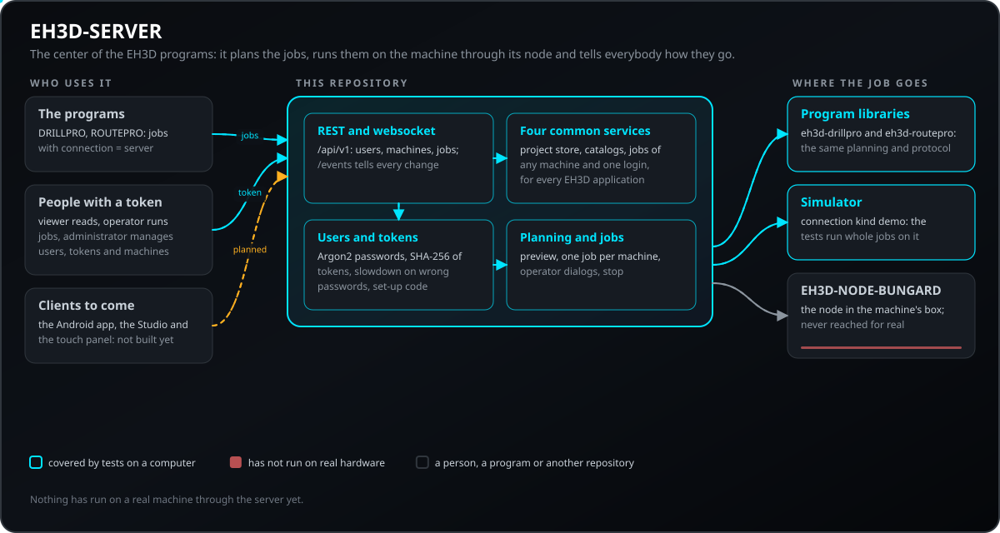
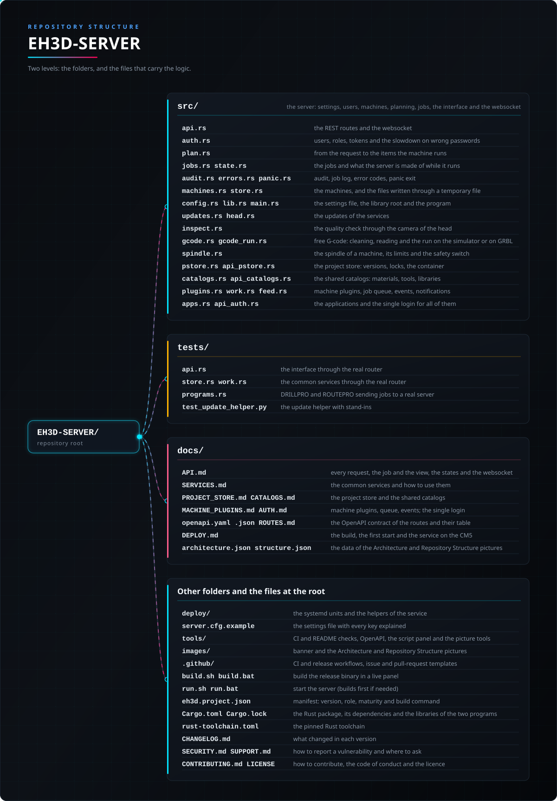

<p align="center">
  
</p>

#  EH3D-SERVER

<p align="center"><a href="README.md">🇺🇸 English</a> | <a href="README_spa.md">🇪🇸 Español</a> | <a href="README_fra.md">🇫🇷 Français</a> | <a href="README_ita.md">🇮🇹 Italiano</a> | <a href="README_deu.md">🇩🇪 Deutsch</a> | 🇨🇳 <b>中文</b> | <a href="README_jpn.md">🇯🇵 日本語</a> | <a href="README_por.md">🇵🇹 Português</a></p>

### EH3D 程序的中心：接收来自 DRILLPRO、ROUTEPRO 和未来客户端的作业，规划作业，通过机床的节点执行，并告知所有人进度

<p align="center">
  
  
  
  
  
</p>

---

**诚实性核对 - 今天真正能运行的内容：** 一个带有 REST 和 websocket 接口的 Rust 服务器（axum），保存用户、机床和作业，使用 EH3D-DRILLPRO 和 EH3D-ROUTEPRO 的库规划钻孔或铣削作业（孔和路径，或带刀具表的 Excellon 或 HP-GL 文件），显示预览，并通过 EH3D-NODE-BUNGARD 或模拟器在机床上执行，带有操作员对话框、停止功能，并实时通告每个变化。41 个测试在计算机上运行，作业针对模拟器运行。**还没有通过它在真实机床上运行过任何东西**，它不终止 TLS，除程序之外的客户端中，EH3D-STUDIO 已存在（从未对真实机床试过），Android 应用和机床旁的面板还不存在。 它也是 EH3D 每个应用的服务器，带有四个公共服务（项目存储、共享目录、带作业队列和事件流的机床插件、统一登录）；它们只在测试中运行，目前没有任何应用使用它们。

---

> **安全（safety）与信息安全现状：** 这不是安全系统（safety）。作业绝不会自行启动：由具有操作员角色的人启动，每台机床一次只运行一个作业，规划会拒绝工作台之外的孔和路径，以及缺失或超出范围的刀具。每个请求都需要令牌（查看者只读，操作员运行作业，管理员管理用户、令牌和机床）；密码以 Argon2 哈希保存，会话令牌和程序令牌只保存 SHA-256，节点的令牌从不会被 API 显示。服务器用于家庭或通往家里的 VPN：在外部任何东西能访问它之前，请在前面加上 HTTPS。机床的停止不只依赖服务器：节点在链路沉默时会自行停止。该项目是独立的：不由 Bungard Elektronik 制造、认可或支持。

## 📋 速览

| | |
|---|---|
| 版本 | `0.1.4` |
| 成熟度 | 可用 |
| 测试 | 360 |
| 技术栈 | Rust (axum, tokio) |
| 真实硬件 | 否：已针对模拟器测试；尚未通过服务器在真实机床上运行过任何东西 |

**跳转到：** [概述](#-概述) · [架构](#-架构) · [快速开始](#-快速开始) · [测试](#-测试) · [结构](#-仓库结构) · [相关项目](#-相关项目)

## 🚦 项目状态

每一行是本仓库的一个部分，灯号表示它今天做到了哪一步。内容依据仓库能够展示的证据（测试、构建、运行），而不是计划。

🟢 已完成并验证 · 🟡 可用，有已知限制 · 🟠 部分完成或尚未验证 · 🔴 未完成或不可用

| 领域 | 状态 | 在这里的含义 |
|---|---|---|
| 软件 | 🟡 | Rust 服务器（axum）保存用户、机床和作业，使用 EH3D-DRILLPRO 和 EH3D-ROUTEPRO 的库规划钻孔和铣削作业，显示预览，并带有操作员对话框和停止功能地运行作业。 |
| 测试 | 🟡 | 360 个测试通过（`cargo test`）：模块内 198 个，接口端到端 162 个，作业在模拟器上运行（`tests/api.rs` 41 个，使用真实程序的 `tests/programs.rs` 7 个）。 |
| 面向客户端的接口（API） | 🟡 | REST 请求和 websocket 事件已写在 `docs/API.md` 和路由的 OpenAPI 契约 `docs/openapi.yaml` 中并被测试覆盖；目前只有程序自带的服务器连接在使用。 |
| 公共服务 | 🟠 | 项目存储、共享目录、带队列和事件的机床插件以及统一登录，都在计算机上的测试中运行；目前没有任何应用使用它们，没有任何东西通过队列在真实机床上运行过，目录也没有载入各程序的真实数据。 |
| 客户端 | 🔴 | EH3D-STUDIO 在使用它（从未对真实机床试过）；Android 应用和机床旁的触摸面板尚不存在。 |
| 安全 | 🟡 | 每个请求都需要带三种角色之一的令牌，密码是 Argon2 哈希，错误密码会被减速；服务器不终止 TLS（请在前面加 HTTPS），也未经独立审查。 |
| 真实硬件 | 🟠 | 作业只针对模拟器运行过：尚未通过服务器在真实机床上运行任何东西。 |
| 部署 | 🟠 | systemd 单元和 `docs/DEPLOY.md` 描述了 CM5 上的服务；本仓库不记录任何已完成的部署。 |
| 集成 | 🟠 | 它使用与 EH3D-DRILLPRO 和 EH3D-ROUTEPRO 相同的库进行规划（它们的文件夹必须与本文件夹并列），并与 EH3D-NODE-BUNGARD 的链路通信，但只通过模拟器到达过。 |
| 文档 | 🟡 | 八种语言的 README、API 参考和作为服务运行的指南。 |

## 🎯 概述

* **作业**：钻孔作业（孔和刀具，或带刀具表的 `.NCD` 文件）或铣削作业（路径和刀具，或带刀具表的 `.PLT` 文件），用程序的库规划，因此客户端画出的和机床做的完全一致；当孔在工作台之外或缺少刀具时，会以一个代码拒绝。
* **自由 G 代码作业：** `kind: gcode` 的作业携带程序文本；服务器会清理它（不含注释，也不含控制器的设置命令），按机器的主轴判断其 `S` 和 `F`，并在模拟器或服务器串口上的 GRBL 控制器（`connection.kind = grbl`，用 `--features serial` 构建）上逐行运行。作业可以暂停（`pause`）、放行（`resume`）和停止（`cancel`），已停止的作业会从到达的行继续：生效的代码会被恢复，作业在第一次移动前等待操作员。只在模拟器上试过，从未在真实的 GRBL 控制器上试过。
* **预览**：按机床执行的顺序列出的工作、带数量的刀具、包围盒、时间估计以及每个孔完成时所处的项目——界面绘制电路板并跟踪作业所需的一切。
* **运行**：作业在有人启动前一直处于就绪状态；它在程序的库上运行（握手、上膛、参考运行、钻孔、停止），在操作员对话框（换刀、确认主轴）处等待，直到有人确认，并且可以被停止；机床停止时驱动器断电。
* **机床**：每台机床的连接方式（通过网络的 EH3D-NODE-BUNGARD，或模拟器）、其配置文件的文本以及在其上调好的数值，因此机床的标定对所有客户端都集中在一个地方。
* **机群和工位**：每台机床属于一个工位（工作台、房间、车间），`GET /api/v1/fleet` 一次回答所有机床，按工位分组，给出每台的状态（空闲、忙碌、等待操作员）、带进度的作业和就绪作业的数量；各机床同时运行，每台一个作业。
* **人和程序**：三种角色的用户、只显示一次的程序令牌、对错误密码的减速，以及控制台上给第一个管理员的设置码。
* **事件**：一个 websocket，实时发送作业的每个变化。
* **服务**：一个可执行文件和一个小的文本设置文件，默认端口 18200（不是 ARMOR 或 HYDRA-UMC 的端口），并带有用于 CM5 的 systemd 单元。
* **计划中、尚未构建**：客户端（Android 应用、机床旁的触摸屏面板）、服务器自身的 HTTPS，以及在服务器消失时利用节点的指示灯和缓冲区完成被保留的作业。
* **对精确计划的空跑，以及每个作业视图中的合理性检查：** 钻孔或铣削作业的步进会在纸面上按控制器读取的方式被跟随，视图带有 `dry_run`（各轴离限位开关的行程范围、计划的终点、步数和秒数）和 `warnings`（单位可能有误、作业大于工作台、比例不等于 1）。使某个轴超出机器文件行程的计划会以 `outside_course` 被拒绝；若机器调校中写有 `dry_run = warn`，则只列出。`dry_run_margin_mm`、`sanity_tiny_mm` 和 `sanity_far_mm` 是同一调校中的键。测量和摘要来自 EH3D-COMMON 中的 `eh3d-summary`，因此每个程序给出的说法都一样。
* **四个公共服务，面向 EH3D 的每个应用：** **项目存储**（保留并校验每个版本的文件、避免两人互相覆盖的 `If-Match`、编辑锁、`.eh3dproj` 容器的导入与导出）、**共享目录**（材料、刀具、机床配置、库和元器件库，带搜索和 `ETag`）、**机床插件**（任何种类的机床都在同一个接口之后、带历史的作业队列、服务器发送事件流和通知）和**统一登录**（应用与角色作为会话的信息、可列出和关闭的会话、密码与锁定策略）。见 [docs/SERVICES.md](docs/SERVICES.md)。

## 🧩 在 EH3D 中的角色

EH3D-SERVER 是 EH3D 家族的中心：程序把作业发给它，它通过节点与机床通信，其他客户端通过同一接口查看和发送相同的作业。它使用 [EH3D-DRILLPRO](https://github.com/JuanenRac/EH3D-DRILLPRO) 和 [EH3D-ROUTEPRO](https://github.com/JuanenRac/EH3D-ROUTEPRO) 的库，并与 [EH3D-NODE-BUNGARD](https://github.com/JuanenRac/EH3D-NODE-BUNGARD) 通信。

## 🏛️ 架构

<p align="center">
  
</p>

本仓库各部分如何协作：谁在使用它、它包含什么、它依赖什么。图片由 `docs/architecture.json` 绘制，并与代码核对。

## ✨ 功能

* **预览就是计划：** 预览和真实运行来自同一次规划，所以客户端画出的就是机床要做的。
* **作业绝不会自行启动：** 作业创建后处于就绪状态，只有操作员能启动；每台机床一次只运行一个作业（`409 machine_busy`）。
* **通过网络的操作员对话框：** 作业在换刀和主轴确认处暂停，直到客户端确认。
* **实时事件：** websocket 实时告知作业的每个变化，连接时会发送作业的摘要。
* **标定集中一处：** 每台机床的配置文件和调好的数值保存在服务器上，所以所有客户端都用相同的数字规划。
* **服务器停止时正在运行的作业会标记为失败：** 没人知道机床当时在哪里，所以不会自动恢复。
* **可靠写入的文件：** 用户、令牌、机床和作业是 JSON 文件，通过临时文件写入，该文件在取代旧文件之前先刷入磁盘，之后再刷新所在文件夹；被替换的文件会作为 `<名称>.bak` 保留一份。损坏的文件仍然是错误，绝不会悄悄地从零重启，但如果副本完好，错误会指出它并说明如何恢复（把它复制到文件上）；副本绝不会自己被加载。
* **来自 GitHub 的更新：** 设置 `updates_dir` 后，服务器向管理员提供检查自身和 EH3D-STUDIO 最新版本并更新的功能（`/api/v1/updates`）；由 systemd 启动的小型辅助程序（`deploy/eh3d-update.py`）负责下载、校验每个文件的 SHA-256、拒绝名称超出其文件夹的压缩包、替换已安装的文件夹（旧的保留为 `.previous`）并重启服务。 它要求签名：机器需要文件 `/etc/eh3d-update.signers`，发布版本必须为每个文件发布可通过验证的 OpenSSH 签名（`.sig`）；没有该文件或没有有效的 `.sig`，就不会安装任何内容。仅凭哈希校验的安装必须有意允许（Studio 安全页面的开关 `update_allow_unsigned`、助手设置中的 `require_signature` 或其选项 `--allow-unsigned`），即便如此，已发布的签名也必须通过验证。它会用发布版本中附带的副本替换自身。已用替身替代 GitHub 和 systemd 测试过，从未在真实安装上运行。管理员还可以恢复上一次更新留下的版本，并清空更新历史。
* **运行：** SIGTERM（`systemctl stop`）会先停止正在运行的机器，再按顺序停止服务器；systemd 单元已加固（`UMask=0077`、`dialout` 组、无主目录、无新权限）；`GET /api/v1/health` 给出版本、接口修订号以及 `ok` 或 `degraded`（磁盘已满或只读，或某次 panic 毒化了锁，服务器现在可以继续运行），已登录的用户会得到更多信息；夜间定时器备份数据文件夹（`deploy/eh3d-backup.py`）；`deploy/Caddyfile.example` 和 `docs/DEPLOY.md` 给出用 Caddy 实现 HTTPS 的方法。这些文件只作为文件测试过，从未在 CM5 上测试。
* **经服务器访问钻头节点：** 当机床配置写明节点（`head_address`、`head_token`）时，服务器转发它的状态（`GET /api/v1/machines/:id/head/status`）、它的 MJPEG 摄像头（`.../head/stream`，浏览器可把令牌放在地址里）和一次工作台测量（`POST .../head/measure`，操作员），这样另一个网络里的程序用同一个登录就能访问。已用替身节点测试，从未对真实节点测试。
* **通过钻头摄像头进行质量检查：** 服务器打开 LED 环形灯，从节点取一张图像，用工坊的分析器判断（每台机床的配置由服务器保存），让环形灯显示结果（绿色或红色闪烁），并保存最近一次检查，供机床旁的屏幕和手机显示：`GET/POST .../head/light`、`GET .../head/snapshot`、`POST/GET .../head/inspect`、`GET/PUT .../head/inspect/profile` 和 `POST .../head/inspect/calibrate`。
* **机床的主轴：** `GET` 和 `PUT /api/v1/machines/:id/spindle` 说明机床装的是哪个主轴（`original` 或 `vfd`）及其限值（转速、切削进给、下刀进给、最粗的钻头）；要求超出的作业会被 `spindle_limit` 拒绝（安全开关 `guard` 默认为 `reject`；设为 `warn` 时作业通过，转速被削减到主轴最大值，每项超出列在 `spindle_warnings` 中）。
* **带版本的项目存储：** 文件从不被覆盖，每次写入都是带 SHA-256 的新版本；对已有文件的写入必须说明它基于哪个版本（`If-Match`）；每次读取都用哈希校验字节；可能跳出文件夹或属于 Windows 的名称会被拒绝。
* **插件背后的机床：** Bungard 机床就是 `bungard` 插件（同样的机床、同样的作业、同样的旧路由），无硬件的 `demo` 插件供测试使用；通用队列保存每个作业的历史，事件流（`GET /api/v1/events/stream`）让客户端凭 `Last-Event-ID` 重新连接而不丢失任何内容。
* **每个应用共用的登录：** 登录会说明它属于哪个应用，每个人可以查看并关闭自己已打开的会话，管理员可以处理任何人的会话；密码与锁定遵循设置，审计记录登录、拒绝和关闭，绝不记录秘密；`GET /api/v1/auth/policy` 向 Studio 展示安全开关。

## 🔒 安全与防护

| 威胁 | 防御 |
|---|---|
| 网络上任何人发送请求 | 除健康检查、首次设置和登录外的每个请求都需要令牌（`Authorization: Bearer`，websocket 用 `?ticket=`）；三种角色：查看者只读，操作员运行作业，管理员管理用户、令牌和机床 |
| 猜测密码 | 五次错误密码会锁定该名称，先 30 秒，只要持续错误就变为 60 秒、120 秒……（`429 throttled`）；响应不会说明哪一部分错误，未知名称与已知名称耗时一样 |
| 数据文件夹的副本 | 密码是 Argon2id 哈希；会话令牌和程序令牌是随机的，只保存其 SHA-256，所以文件夹的副本无法让任何人登录；节点的令牌从不会被 API 显示 |
| 接管全新的服务器 | 第一个管理员用只在控制台打印的设置码创建 |
| 把所有人锁在外面 | 最后一个管理员不能被删除、停用或降级（`409 last_admin`） |
| 自行启动的作业，或一台机床上的第二个作业 | 作业创建后处于就绪状态，只有操作员能启动，一台机床一次只运行一个作业 |
| 会撞到工作台或使用缺失刀具的计划 | 规划会以代码拒绝工作台之外的孔和路径，以及缺失或超出范围的刀具 |
| 机床运动时服务器崩溃 | 节点在链路沉默时自行停止；作业被标记为失败，绝不自动恢复；服务在收到 SIGINT 时停止其作业 |
| 巨大的请求 | 请求体有大小限制（`max_body_mb`，默认 8 MB） |
| 不知道谁做了什么 | 每次登录（含失败）、作业、停止和更改都会在控制台和 `audit.jsonl` 中留下一行审计；作业会记录启动者和停止者；不写入任何机密 |
| 客户端在代理头中写入自己的地址 | 仅当 `trust_forwarded_for` 开启且连接来自 127.0.0.1 时才信任 `X-Forwarded-For`；默认关闭 |
| 遗留在借出笔记本电脑上的程序令牌 | 令牌可以设置过期（`days`、`token_default_days`），列表会显示每个令牌最后一次使用的时间 |
| 服务器线程发生 panic | 启用 `exit_on_panic`（默认开启）时，正在运行的作业会被停止，服务器退出并由 systemd 重新启动 |
| 损坏的数据文件 | 报错，绝不悄悄从零开始 |
| 权限过多的服务 | systemd 单元以专用用户运行，带有 `NoNewPrivileges`、`ProtectSystem=strict`、`PrivateTmp` 和唯一一个可写文件夹 |
| 作业向主轴要求超出其能力 | 机床选定主轴后，规划会拒绝超出限值的转速或进给（`422 spindle_limit`），创建作业和启动时都会检查；开关默认为 `reject`，除非管理员设为 `warn` |

**没有防御的内容：** 服务器不终止 TLS，所以除非在前面加 HTTPS，令牌和密码会以明文穿过网络；websocket 的令牌在地址中；也未经独立审查。请私下报告漏洞（见 [SECURITY.md](SECURITY.md)）。

## 🔌 接口

| 接口 | 内容 | 位置 |
|---|---|---|
| REST | `/api/v1/`：`health`、`setup`、`login`、`logout`、`session`、`account`、`users`、`tokens`、`machines`（含 `preview` 和 `jobs`）、`jobs`（含 `start`、`confirm`、`cancel`）；输入输出均为 JSON，错误形如 `{"error","detail"}` | [docs/API.md](docs/API.md)、`src/api.rs` |
| Websocket | `GET /api/v1/events?ticket=...`：先发含作业摘要的 `hello`，之后每个变化发送 `job` 和 `job_removed` | [docs/API.md](docs/API.md) |
| 通往机床 | 机床的 `connection` 为 `node`（位于某地址、带令牌的 EH3D-NODE-BUNGARD）或 `demo`（模拟器） | [docs/API.md](docs/API.md)、`src/machines.rs` |
| 命令行 | `eh3d-server [--config FILE]`；`--help` 会列出 | `src/main.rs` |
| 服务 | 一个可执行文件，默认端口 18200，一个 systemd 单元 | [docs/DEPLOY.md](docs/DEPLOY.md)、`deploy/eh3d-server.service` |
| 公共服务 | `/api/v1/apps/{app}/projects`、`catalogs`、`plugins`、`work`、`notifications`、`auth`；`GET /api/v1/events/stream` 发送服务器发送事件 | [docs/SERVICES.md](docs/SERVICES.md)、[docs/openapi.yaml](docs/openapi.yaml) |

## ⚙️ 配置

`server.cfg`（或用 `--config` 指定的文件）有 73 个可选键；未知的键或超出范围的值在启动时会报错。`server.cfg.example` 有说明。

| 键 | 默认值 | 范围 | 作用 |
|---|---|---|---|
| `listen` | `127.0.0.1:18200` | 地址和端口 | 服务器监听的位置；默认只有本机（18200 是它自己的端口） |
| `network_open` | `false` | true 或 false | 当 `listen` 只是本机时，在计算机的所有地址上监听；安全页面的开关，在服务器启动时读取 |
| `update_allow_unsigned` | `false` | true 或 false | 当哈希正确时，允许更新助手安装没有签名的发布版本；安全页面的开关（关闭：必须有签名） |
| `data_dir` | `data` | 文件夹 | 保存用户、令牌、机床和作业的位置；请备份 |
| `session_hours` | 12 | 1 到 720 | 登录持续多久 |
| `max_body_mb` | 8 | 1 到 256 | 最大的请求，单位 MB |
| `keep_jobs` | 200 | 10 到 100,000 | 列表保留多少已完成的作业 |
| `exit_on_panic` | `true` | true 或 false | 线程发生 panic 时：停止机床并退出，由服务重启（false：只记录 panic） |
| `trust_forwarded_for` | `false` | true 或 false | 仅在来自 127.0.0.1（本地代理）的连接上，从 `X-Forwarded-For` 取客户端地址 |
| `persist_sessions` | `false` | true 或 false | 把登录保存在磁盘上（只存每个令牌的哈希），重启后无人被登出 |
| `token_default_days` | 0 | 0 到 3650 | 未指定时程序令牌的有效天数（0：不过期） |
| `events_ping_s` | 30 | 1 到 3600 | 事件 websocket 两次 ping 之间的秒数 |
| `events_idle_s` | 90 | 2 到 86400 | 该 websocket 在多少秒无任何响应（pong 也算）后被关闭 |
| `audit_file` | `true` | true 或 false | 除控制台外，把审计记录（谁做了什么）写入 `audit.jsonl` |
| `job_log` | `true` | true 或 false | 在每个作业开始和结束时向 `eh3d-jobs.log` 写一行 |
| `log_max_kb` | 1024 | 16 到 1048576 | 审计与作业记录达到多少 KB 时归档（保留一份旧副本） |

公共服务的上限和开关（存储、目录、队列、事件流、登录、密码）是同一个文件里的键，每个都在 `server.cfg.example` 中有说明；`GET /api/v1/auth/policy` 向管理员展示安全开关。

用户和令牌的名称：字母、数字、`.`、`_` 和 `-`，最多 32 个字符；密码：8 到 128 个字符。各机床上调好的数值不在这里：它们保存在机床记录中，格式与程序的机床文件相同。

## 🚀 快速开始

需要稳定版 Rust 工具链，并且 EH3D-DRILLPRO 和 EH3D-ROUTEPRO 要与本文件夹并列（服务器使用它们的库）。

```bash
cargo build --release
cargo test
cargo clippy --all-targets -- -D warnings
cargo fmt --all --check
python -I tools/ci_validate.py
```

用 `run.bat`（Windows）或 `./run.sh`（Linux）运行；需要时会先编译。在没有用户时，控制台会显示设置码：用 `POST /api/v1/setup` 创建管理员，登录，用节点的地址和令牌添加机床，并为每个程序创建令牌。`server.cfg.example` 列出了设置；`docs/DEPLOY.md` 说明如何在 CM5 上作为服务安装。

## 🧪 测试

测试共 360 个（`cargo test`，CI 中在 Windows 和 Linux 上运行，COMMON, DRILLPRO 和 ROUTEPRO 检出在服务器旁）：模块内 198 个（设置及其范围、用户、角色、令牌、对错误密码的减速、文件和作业簿、规划），通过真实路由器的接口端到端 41 个（`tests/api.rs`），维护客户端所读响应示例的 2 个（`tests/examples.rs`），以及真实程序通过真实端口把作业发给真实服务器、机床使用模拟器的 7 个（`tests/programs.rs`）。`tests/` 中的其他文件另有 106 个（四个公共服务及其文档、产物、计算任务、共享、事件、错误目录、API 文档中的路由、信号停止与一次 panic）。CI 还运行 `cargo fmt --all --check`、将警告视为错误的 `cargo clippy` 和 `python -I tools/ci_validate.py`。这里没有任何东西针对真实节点或机床测试过。 负责更新的辅助程序另有 23 项自己的测试（`python -I tests/test_update_helper.py`，用替身替代 GitHub 和 systemd）。另有两个测试文件检查：使锁中毒的 panic 不会使服务器停止（`tests/poison.rs`），以及真实的二进制文件在收到 SIGTERM 时停止（`tests/sigterm.rs`，在 Linux 上）；备份和部署文件各有 7 个和 8 个自己的测试（`tests/test_backup.py`、`tests/test_deploy_files.py`）。 另有两个测试文件分别在真实套接字上检查事件 websocket（`tests/events.rs`，3 个测试），并对照服务器源码检查错误代码目录（`tests/errors.rs`，3 个测试）。 路由契约通过 `tests/openapi.rs`（6 个测试）和 `python -I tools/check_openapi.py` 对照路由器检查，后者也在 CI 中运行。

## 🏗️ 构建与发布

版本号位于 `Cargo.toml` 和 `eh3d.project.json`，每个版本在 [CHANGELOG.md](CHANGELOG.md) 中都有条目。`build.sh` / `build.bat` 在实时面板中编译发布二进制（`target/release/eh3d-server`），`test.sh` / `test.bat` 只运行测试；两者都不会更改版本。尚未发布任何版本。在 CM5（aarch64 Linux）上请在机器本身上编译；`docs/DEPLOY.md` 说明如何作为服务安装。

## 📂 仓库结构

<p align="center">
  
</p>

<details>
<summary>目录树的文本版</summary>

```text
EH3D-SERVER/
├── src/
│   ├── api.rs                                   REST 路由和 websocket
│   ├── auth.rs                                  用户、角色、令牌和对错误密码的减速
│   ├── plan.rs                                  从请求到机床执行的项目
│   ├── jobs.rs state.rs                         作业以及服务器运行时的组成
│   ├── audit.rs errors.rs panic.rs              审计、作业记录、错误代码、panic 退出
│   ├── machines.rs store.rs                     机床以及通过临时文件写入的文件
│   ├── config.rs lib.rs main.rs                 设置文件、库根和程序
│   ├── updates.rs  head.rs                      服务的更新
│   ├── inspect.rs                               通过钻头摄像头进行质量检查
│   ├── gcode.rs gcode_run.rs                    自由 G 代码：清理、解析，以及在模拟器或 GRBL 上运行
│   ├── spindle.rs                               机床的主轴、其限值和安全开关
│   ├── pstore.rs api_pstore.rs                  项目存储：版本、锁、容器
│   ├── catalogs.rs api_catalogs.rs              共享目录：材料、刀具、库
│   ├── plugins.rs work.rs feed.rs api_work.rs   机床插件、作业队列、事件、通知
│   └── apps.rs api_auth.rs                      各个应用以及它们共用的统一登录
├── tests/                                       模拟器上的接口端到端测试，以及真实程序对真实服务器
├── docs/                                        API、其 OpenAPI 契约、运行服务器的指南和两张图的数据
├── deploy/                                      systemd 单元和服务的辅助程序
├── server.cfg.example                           为每个键附有说明的设置文件
├── tools/                                       CI 与 README 检查、OpenAPI、脚本面板和绘图工具
├── images/                                      横幅图以及架构和仓库结构图片
├── .github/                                     CI 与发布工作流、Issue 和 PR 模板
├── build.sh build.bat                           在实时面板中编译发布二进制
├── run.sh run.bat                               启动服务器（需要时先编译）
├── eh3d.project.json                            清单：版本、角色、成熟度和构建命令
├── Cargo.toml Cargo.lock                        Rust 包、其依赖及两个程序的库
├── rust-toolchain.toml                          固定的 Rust 工具链
├── CHANGELOG.md                                 每个版本的变更
├── SECURITY.md SUPPORT.md                       如何报告漏洞及在哪里提问
└── CONTRIBUTING.md CODE_OF_CONDUCT.md LICENSE   参与贡献、行为准则和许可证
```

</details>

## 🗺️ 路线图与已知限制

**目前已知的限制**

* 尚未通过服务器在真实机床上运行过任何东西：作业只针对模拟器运行过，与 EH3D-NODE-BUNGARD 的链路也没有真正连通过。
* 服务器不终止 TLS；在外部任何东西能访问它之前，请在前面加上 HTTPS。它未经独立审查。
* 除程序之外的客户端中，EH3D-STUDIO 已存在；Android 应用和触摸面板还不存在。
* 它需要 EH3D-DRILLPRO 和 EH3D-ROUTEPRO 的文件夹在旁边，因为它使用它们的库。
* 服务器停止时正在运行的作业会标记为失败，不会恢复。
* 目前没有任何应用使用公共服务（项目存储、目录、通用队列、统一登录）：它们只在计算机上做了描述和测试，没有用真实客户端或真实机床试过。

**下一步**

* 通过服务器和节点在真实机床上运行一个完整的作业。
* 在服务器自身中支持 HTTPS。
* 在服务器消失时，利用节点的指示灯和缓冲区完成被保留的作业。
* 构建程序之外的第一个客户端。

## 🌍 语言

README 和文本提供英语、西班牙语、法语、意大利语、德语、汉语、日语和欧洲葡萄牙语版本。

## 🔗 相关项目

* [EH3D-DRILLPRO](https://github.com/JuanenRac/EH3D-DRILLPRO)：钻孔程序；其库负责规划和运行钻孔作业
* [EH3D-ROUTEPRO](https://github.com/JuanenRac/EH3D-ROUTEPRO)：铣削程序；其库负责规划铣削作业
* [EH3D-NODE-BUNGARD](https://github.com/JuanenRac/EH3D-NODE-BUNGARD)：位于机床机箱中、服务器与之通信的节点
* [EH3D-COMMON](https://github.com/JuanenRac/EH3D-COMMON)：家族的公共部分

## 📚 文档

* [API](docs/API.md)：每个请求、作业以及客户端绘制的视图、状态和 websocket。
* [路由](docs/openapi.yaml)：每个路由的 OpenAPI 契约（角色、范围、模式、示例和错误代码），其表格在 [docs/ROUTES.md](docs/ROUTES.md)。
* [公共服务](docs/SERVICES.md)：项目存储、共享目录、带队列和事件的机床插件和统一登录，各有专页（[PROJECT_STORE.md](docs/PROJECT_STORE.md)、[CATALOGS.md](docs/CATALOGS.md)、[MACHINE_PLUGINS.md](docs/MACHINE_PLUGINS.md)、[AUTH.md](docs/AUTH.md)）。
* [设计运行、审计和安全开关](docs/DESIGN_RUN.md)：在项目的电路板上运行已安装的设计程序，报告保存为项目的文件；以及管理员在服务器运行时可以查看和修改的内容（[AUTH.md](docs/AUTH.md)）。
* [运行服务器](docs/DEPLOY.md)：编译、首次启动、CM5 上的服务以及部署的安全性。
* [变更日志](CHANGELOG.md)

## 🤝 参与贡献与社区

* 提交 pull request 之前请运行 `cargo fmt --all --check`、`cargo clippy --all-targets -- -D warnings`、`cargo test` 和 `python -I tools/ci_validate.py`，全部通过。参见 [CONTRIBUTING.md](CONTRIBUTING.md) 和[行为准则](CODE_OF_CONDUCT.md)。
* README 有八种语言：修改文字时要同步修改全部八个文件，两张图片由 `tools/make_architecture.py` 和 `tools/make_structure.py` 根据 `docs/architecture.json` 和 `docs/structure.json` 绘制。
* 修改 API 的路由时，需要在 `docs/API.md` 中添加相应条目、通过真实路由器的测试，对会修改内容的请求还要指定允许执行它的角色。OpenAPI 文档中也需要有对应的操作：运行 `python tools/make_openapi.py`，它会写出 `docs/openapi.yaml`、`docs/openapi.json` 和 `docs/ROUTES.md`。
* 请私下报告漏洞：[SECURITY.md](SECURITY.md)。问题、想法和报告：electrohobby3d@gmail.com（[SUPPORT.md](SUPPORT.md)）。

## 👤 作者

**JuanenRac (Electro Hobby 3D)** · electrohobby3d@gmail.com

## 📜 许可证

软件：GPL-3.0-or-later。见 [LICENSE](LICENSE)。套件的硬件设计使用 CERN OHL-S。
